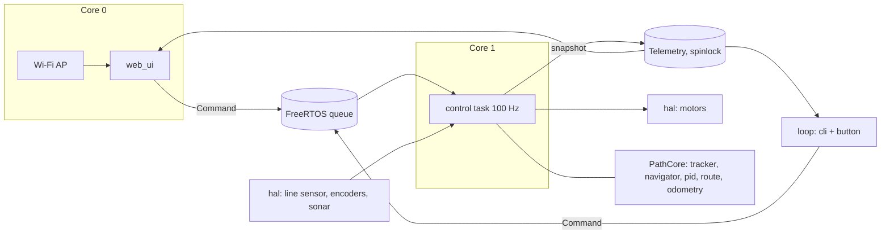
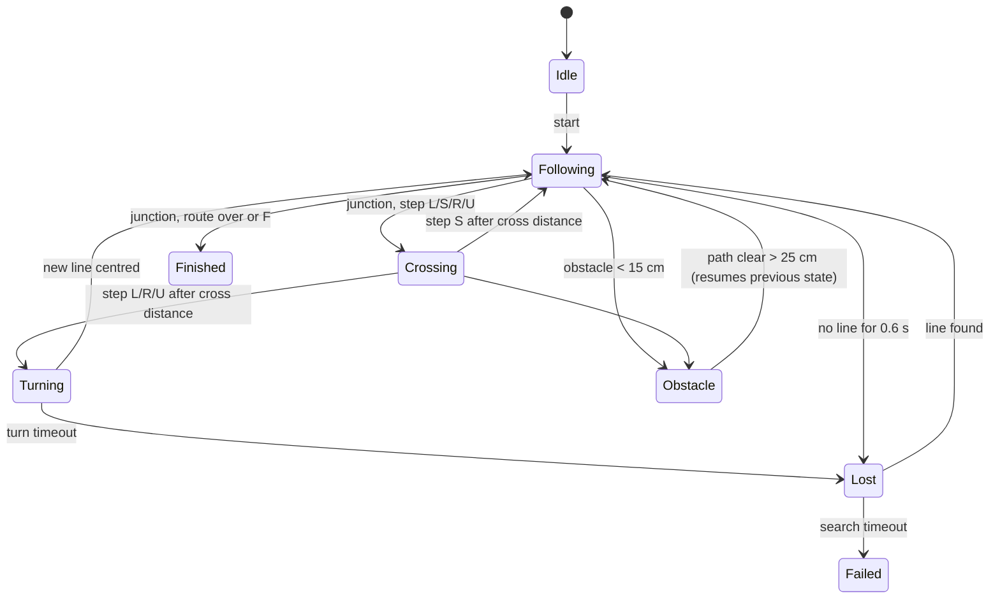

# PathPilot S3

Autonomous line-following vehicle on **ESP32-S3** that drives a **predefined route**: it follows a black line, recognises junctions and executes one route step per junction (`L`eft, `S`traight, `R`ight, `U`-turn, `F`inish). It stops for obstacles, searches for a lost line, and streams live telemetry to a browser dashboard over its own Wi-Fi access point.

The control logic lives in a hardware-independent C++ library (`lib/PathCore`) that is covered by unit tests on a PC, including a closed-loop kinematic simulation. Only the thin HAL layer in `src/hal` touches ESP32 peripherals, so the same core can be ported to another MCU (for example PSoC™ 6) by rewriting the HAL files.

---

## Features

- 100 Hz control loop in a dedicated FreeRTOS task pinned to core 1 (Wi-Fi runs on core 0)
- 5-channel analog line sensor with min/max calibration stored in NVS
- weighted line position + PID steering with anti-windup and curve slow-down
- junction detection and route execution (`"SLRUF"`, up to 32 steps)
- turn completion by "left old line → found new line" or odometry heading, with timeout
- wheel odometry from quadrature encoders (distance, heading, x/y trail)
- obstacle stop with hysteresis (HC-SR04, measured in an interrupt, non-blocking)
- line-lost recovery: search spin towards the side the line was last seen, then `FAILED`
- thread-safe command queue (web, serial and button never touch the control state directly)
- web dashboard: state, sensor bar, route progress, live trajectory, PID tuning
- serial CLI and Serial Plotter stream
- 17 unit tests (PID, line tracker, route, odometry, navigator, closed loop)

## Hardware

| Part | Example | Notes |
|---|---|---|
| MCU board | ESP32-S3-DevKitC-1 | any ESP32-S3 board works, adjust pins |
| Motor driver | TB6612FNG | L298N also works, but loses more voltage |
| Motors | 2× N20 / TT gear motor **with encoders** | set `ENC_TICKS_PER_REV` |
| Line sensor | 5-channel analog IR array (TCRT5000 type) | analog outputs, not digital |
| Distance sensor | HC-SR04 | echo pin needs a 5 V → 3.3 V divider |
| Power | 2S Li-ion (7.4 V) → motor driver VM, 5 V buck → board | common ground everywhere |

Track: black tape 15–25 mm wide on a light surface. Junctions are crossings or T-junctions where at least 4 of 5 sensors see black at once. Plain curves without branches are followed by the PID and do **not** consume a route step.

## Wiring

| Signal | ESP32-S3 GPIO | Connects to |
|---|---|---|
| Line sensors S1…S5 (left → right) | 1, 2, 3, 4, 5 | analog outputs (ADC1) |
| PWMA / AIN1 / AIN2 | 10 / 11 / 12 | TB6612 left motor |
| PWMB / BIN1 / BIN2 | 13 / 14 / 15 | TB6612 right motor |
| STBY | 16 | TB6612 standby |
| Left encoder A / B | 39 / 40 | |
| Right encoder A / B | 41 / 42 | |
| Sonar TRIG / ECHO | 6 / 7 | ECHO through divider (e.g. 1 kΩ / 2 kΩ) |
| Start / stop button | 0 | on-board BOOT button |

All pins are in [`include/config.h`](include/config.h). Line sensors must stay on ADC1 (GPIO 1–10): ADC2 cannot be used while Wi-Fi is on. Avoid GPIO 35–37 on boards with octal PSRAM.

## Project structure

```
pathpilot-s3/
├── platformio.ini            build environments: esp32s3, esp32s3_core3, native
├── include/
│   ├── config.h              pins, wheel geometry, timing, wi-fi, default route
│   └── app.h                 Command / Telemetry types, app API
├── lib/PathCore/src/         hardware-independent core (unit tested on PC)
│   ├── pid.h/.cpp            PID with anti-windup and output clamp
│   ├── line_tracker.h/.cpp   calibration, normalisation, line position, junctions
│   ├── route.h/.cpp          route parser and step iterator
│   ├── odometry.h/.cpp       differential-drive dead reckoning
│   └── navigator.h/.cpp      state machine: follow, cross, turn, obstacle, lost
├── src/
│   ├── main.cpp              setup, loop, start/stop button
│   ├── control.cpp           100 Hz control task, command queue, telemetry snapshot
│   ├── web_ui.h/.cpp         Wi-Fi AP, dashboard page, REST API
│   ├── cli.h/.cpp            serial commands and plotter stream
│   └── hal/
│       ├── motors.h/.cpp     TB6612 + LEDC PWM (core 2.x and 3.x API)
│       ├── encoders.h/.cpp   quadrature counting in IRAM interrupts
│       ├── line_sensor.h/.cpp  ADC reads + calibration in NVS (Preferences)
│       ├── sonar.h/.cpp      HC-SR04 with interrupt-measured echo
│       └── fast_gpio.h       register-level pin read, safe while flash cache is off
├── test/test_core/test_main.cpp   Unity tests for PathCore
└── docs/PROJECT_UA.md        project description and pitch (Ukrainian)
```

## Architecture



One control cycle: drain commands → trigger sonar (every 60 ms) → read encoder deltas → update odometry → read and normalise line sensors → navigator update → set motors → publish telemetry. A cycle takes well under 1 ms; the dashboard shows the measured `loop_us`.

### Navigator state machine



Key algorithms:

- **Line position**: each sensor is normalised to 0…1 with its own calibration, values below a noise floor are ignored, and the position is the weighted mean of sensor weights −1…+1. When the line disappears, the position saturates to the last seen side, so the PID turns back toward it.
- **Junction**: ≥ 4 of 5 sensors active, ignored for 0.2 s after entering `Following` so the same junction is never counted twice.
- **Turn**: the robot first drives `cross_distance_m` past the junction so the wheel axis is over it, then spins in place until the old line has left the sensors (or the heading changed by ≥ 35°, ≥ 125° for U-turn) and a new line is centred.
- **PID**: derivative on error, integral clamped so the I-term alone cannot exceed the output limit.

## Build and flash

Requires [PlatformIO](https://platformio.org/) (VS Code extension or CLI).

```bash
pio run -e esp32s3 -t upload        # official espressif32 platform (arduino core 2.x)
pio run -e esp32s3_core3 -t upload  # pioarduino platform (arduino core 3.x)
pio device monitor                  # 115200 baud
```

The code compiles on both core versions (`motors.cpp` switches the LEDC API). The `esp32s3_core3` environment was built without warnings from project sources. On the DevKitC-1 use the **UART** USB port for the serial monitor, or add `-DARDUINO_USB_CDC_ON_BOOT=1` if you use the native USB port.

## First run checklist

1. **Wheels in the air.** Run `status` in the serial monitor, rotate each wheel forward by hand: `dist` must grow. If it falls, flip `ENC_L_INVERT` / `ENC_R_INVERT`.
2. **Motor direction.** Send `speed 0.3`, then `start` with the robot off the track: both wheels must spin forward. If not, flip `MOTOR_L_INVERT` / `MOTOR_R_INVERT`.
3. **Line sensors.** `status` prints `raw=…`; values must be higher over black. If they are lower, set `LINE_DARK_IS_HIGH = false`.
4. **Calibrate.** Place the sensor bar over the line and press *Calibrate* (or send `cal`). The robot sweeps left/right for 4 s and saves min/max to flash. The dashboard warns `NOT CALIBRATED` until every sensor has seen both colours.
5. **Route and start.** Set a route (`route SLRF`), place the robot on the line and press *Start* or the BOOT button.

## Web dashboard and API

Connect to Wi-Fi **PathPilot-S3** (password `pathpilot`) and open **http://192.168.4.1**.

| Endpoint | Description |
|---|---|
| `GET /` | dashboard |
| `GET /api/status` | telemetry JSON: state, route, line position and levels, raw ADC, obstacle, odometry, motors, PID, loop time |
| `GET /api/cmd?c=start\|stop\|cal` | control commands |
| `GET /api/route?r=SLRUF` | set route; returns 400 on invalid input |
| `GET /api/tune?kp=1.2&ki=0&kd=0.06&speed=0.55` | PID gains and base speed (missing params keep current values) |

## Serial CLI

| Command | Action |
|---|---|
| `start` / `stop` | start or stop the run |
| `cal` | line sensor calibration |
| `route SLRUF` | set route |
| `pid 1.2 0 0.06` | set PID gains |
| `speed 0.5` | base speed 0.1…1.0 |
| `status` | print state, sensors, odometry, PID |
| `log` | toggle a 10 Hz `pos/ml/mr/obstacle` stream for the Serial Plotter |

## Testing

### Unit tests on a PC (no hardware)

```bash
pio test -e native
```

Without PlatformIO, with any C++17 compiler and [Unity](https://github.com/ThrowTheSwitch/Unity):

```bash
git clone --depth 1 https://github.com/ThrowTheSwitch/Unity.git /tmp/unity
gcc -c /tmp/unity/src/unity.c -I/tmp/unity/src -o unity.o
g++ -std=c++17 -Wall -I/tmp/unity/src -Ilib/PathCore/src \
    lib/PathCore/src/*.cpp test/test_core/test_main.cpp unity.o -o test_core && ./test_core
```

What is covered:

| Area | Tests |
|---|---|
| PID | proportional + clamp, anti-windup recovery, derivative |
| Line tracker | centre/left/right position, lost line keeps side, junction, calibration |
| Route | parsing with separators and lowercase, sequence, invalid input keeps old route, 32-step limit |
| Odometry | straight drive, spin in place |
| Navigator | steering sign, straight junction, left turn until reacquired, finish, obstacle stop/resume with hysteresis, lost → failed |
| Closed loop | kinematic robot starting 2 cm off the line converges to < 5 mm within 6 s |

### Bench tests on the robot

| Check | How |
|---|---|
| sensors | `status`, move a strip of tape under each sensor |
| encoders and odometry | push the robot 1 m along a ruler, `dist` should read ≈ 1.00 |
| heading | rotate the robot 360° by hand, `heading` ≈ ±360 |
| sonar | hand in front of the sensor, `obstacle` follows the distance |
| PID | `log` + Arduino Serial Plotter, watch `pos` oscillations |

## PID tuning

1. Set `ki = 0`, `kd = 0`, `speed 0.4`.
2. Increase `kp` until the robot follows curves and starts to oscillate slightly on straights.
3. Add `kd` (≈ 0.03–0.1) until oscillations disappear.
4. Raise `speed`, repeat. Add a small `ki` only if the robot drifts to one side on long straights.

## Configuration

Hardware values are in `include/config.h`; behaviour values are in `NavConfig` (`lib/PathCore/src/navigator.h`):

| Parameter | Default | Meaning |
|---|---|---|
| `base_speed` | 0.55 | cruise duty, also set via `speed` |
| `turn_speed` | 0.45 | spin speed at junctions |
| `cross_distance_m` | 0.06 | drive past a junction before turning (≈ sensor bar to wheel axis) |
| `obstacle_stop_m` / `obstacle_clear_m` | 0.15 / 0.25 | stop and resume thresholds |
| `lost_timeout_s` / `search_timeout_s` | 0.6 / 3.0 | lost line handling |
| `turn_min_rad` / `uturn_min_rad` | 0.6 / 2.2 | minimal heading change for a turn |

## Porting to another MCU

`lib/PathCore` uses only standard C++. To move to PSoC™ 6 or another MCU, reimplement `src/hal/*` (PWM, ADC, encoder counting, distance sensor, non-volatile storage) and the task/queue code in `src/control.cpp` with the target RTOS. The tests stay unchanged.

## Known limitations

- Junction detection needs a branch wide enough to cover 4 of 5 sensors; sharp 90° corners without a branch are handled by the PID only.
- Odometry drifts with wheel slip; it is used for turn sanity checks and visualisation, not for absolute navigation.
- HC-SR04 sees only a narrow cone in front; side obstacles are not detected.
- Web server is synchronous and runs in `loop()`; it never blocks the control task, but the dashboard may lag under heavy polling.

## License

MIT
